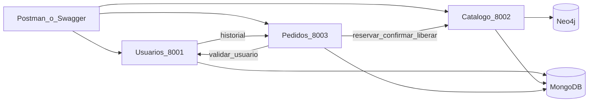
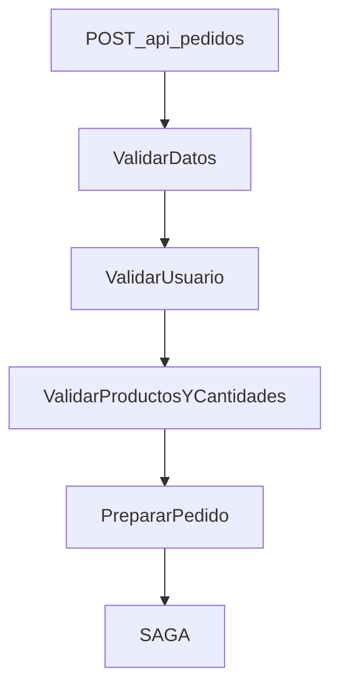
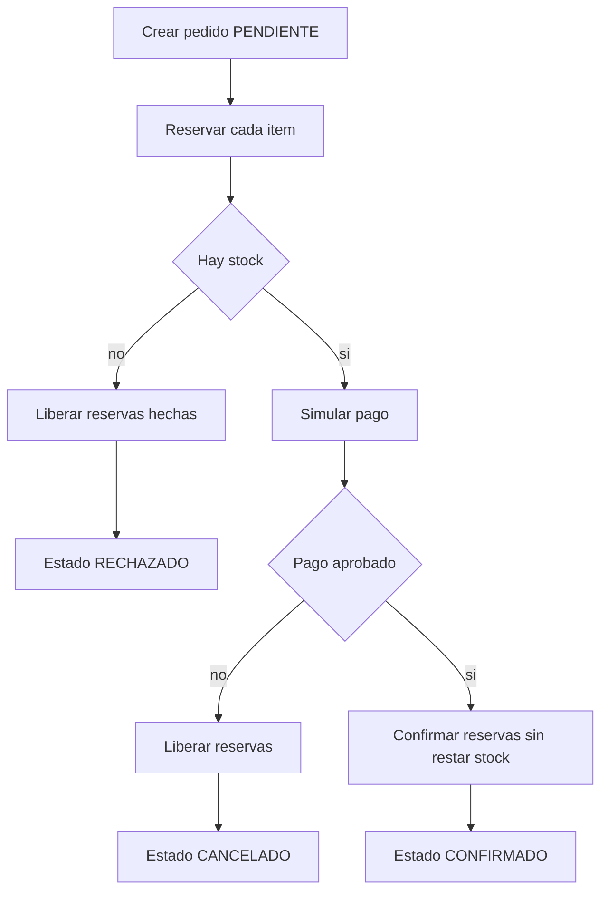

# ShopExpress

Tres microservicios FastAPI, MongoDB y Neo4j. El plan de implementación está en `PLAN_DESARROLLO_SHOPEXPRESS.md`. Cómo se llegó a esas decisiones está en `BITACORA.md`.

No hay frontend. La demo se hace con Postman, con Swagger en `/docs` de cada servicio, y con el navegador de Neo4j en el puerto 7474.

## Decisiones

- **Usuarios** guarda el perfil en MongoDB. Las direcciones van embebidas. El historial no se copia: `GET /api/usuarios/{id}` se lo pide a Pedidos.
- **Catálogo** guarda producto, categoría, marca y `RELACIONADO_CON` en Neo4j. Es el modelo por referencia. El precio de la ficha sale de ahí.
- **Inventario** es un documento MongoDB por producto. `disponible` ya descuenta las reservas activas. Reservar es una sola escritura condicional (`disponible >= cantidad`). Confirmar solo cambia el estado a `CONFIRMADA`.
- **Pedidos** guarda el pedido en MongoDB. Los ítems y el pago van embebidos, con el precio del momento de la compra. `usuario_id` y `producto_id` son referencias. El total lo calcula el backend con `Decimal`.
- Las lecturas de usuario y de ficha priorizan un documento o un nodo por id. La consistencia fuerte está en la reserva de stock. No hay una transacción que cruce Neo4j y MongoDB: si el alta de un producto deja una sola de las dos escrituras, el reintento completa la que falta y no pisa el stock ya creado.
- La cadena de responsabilidad solo valida. La SAGA, en el mismo proceso de Pedidos, reserva, cobra y confirma, y compensa si el stock o el pago fallan. No es un contenedor aparte.
- Pago simulado: `TARJETA_CREDITO` aprueba. `TARJETA_RECHAZADA` rechaza y libera las reservas.

CQRS, Event Sourcing y seudonimización no están implementados. El corte actual ya separa la escritura de stock (MongoDB) de la lectura de relaciones (Neo4j). Un paso siguiente sería proyectar el stock a una vista de lectura y enmascarar documento y email en una exportación.

## Cómo levantarlo

Desde esta carpeta:

```bash
docker compose up --build -d
docker compose ps
```

Cuando los cinco contenedores están healthy:

| Qué | Dónde |
|---|---|
| Usuarios | http://localhost:8001/docs |
| Catálogo | http://localhost:8002/docs |
| Pedidos | http://localhost:8003/docs |
| Neo4j Browser | http://localhost:7474 (usuario `neo4j`, clave `shopexpress`) |
| MongoDB | `localhost:27017` |

```bash
pip install -r tests/requirements.txt
pytest -q
```

Postman CLI, si está instalado:

```bash
postman collection run postman/ShopExpress.postman_collection.json -e postman/local.postman_environment.json
```

La colección también se puede importar en la app de Postman y correr en orden. Para bajar todo:

```bash
docker compose down
```

Estas pruebas no se ejecutaron en la máquina donde se generó el código. Hay que correrlas con Docker arriba.

## API

- `POST /api/usuarios` y `GET /api/usuarios/{usuario_id}` (`?historial=false` omite la consulta a Pedidos; lo usa la validación del pedido).
- `POST /api/productos`, `GET /api/productos/{producto_id}` (incluye `disponible`), `GET /api/productos/{producto_id}/relacionados`, `GET /api/productos`.
- `POST /api/inventario/reservas`, `POST /api/inventario/reservas/{id}/confirmar`, `POST /api/inventario/reservas/{id}/liberar`.
- `POST /api/pedidos`, `GET /api/pedidos/{pedido_id}`, `GET /api/pedidos?usuario_id=`.

`POST /api/pedidos` acepta el header `Idempotency-Key`. La misma clave devuelve el mismo pedido y no vuelve a reservar ni a cobrar.

Estados del pedido: `PENDIENTE`, `CONFIRMADO`, `RECHAZADO` (sin stock), `CANCELADO` (pago rechazado). `saga_paso` es una extensión para ver en qué punto quedó la SAGA.

Para probar una caída a mitad de camino, el primer `POST /api/pedidos` puede llevar `X-Pausar-Saga: RESERVADO`. El stock queda reservado y el pago no se simula. `POST /api/pedidos/reanudar` sigue desde ahí. Es la misma función que corre al arrancar Pedidos. Un segundo reanudar no genera otra transacción ni descuenta de nuevo.

## Diagramas

### Arquitectura



### Chain of Responsibility



### SAGA



Los mismos diagramas están en `docs/diagramas.md`.

## Límites

- Un solo nodo de MongoDB y uno de Neo4j. No hay réplicas ni lectura eventual real: el diseño deja escrito dónde iría cada consistencia.
- El pago no llama a un medio de pago externo.
- No hay autenticación, carrito, broker ni gateway.
- La exportación anonimizada de usuarios no está implementada.
- `docker compose down -v` borra los volúmenes y con eso los datos.
