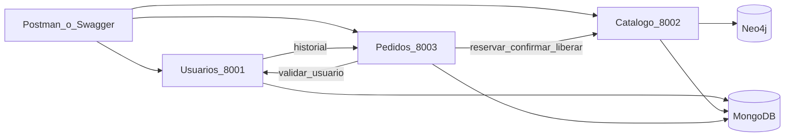
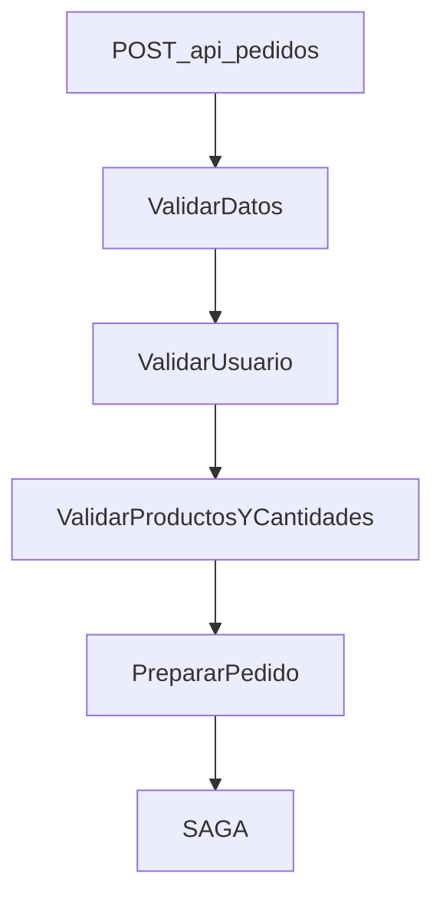
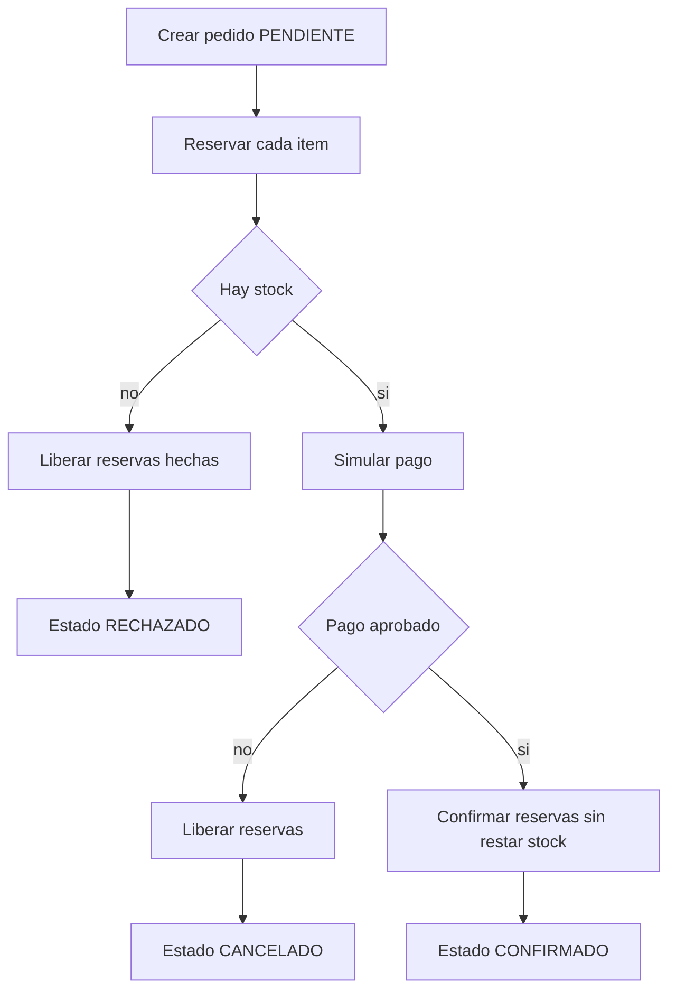

# Diagramas

## Arquitectura

## Chain of Responsibility

Corre dentro de Pedidos, antes de escribir el pedido.

## SAGA

También corre dentro de Pedidos. Cada reserva es atómica en su documento de MongoDB. Si una falla, se liberan las anteriores.

